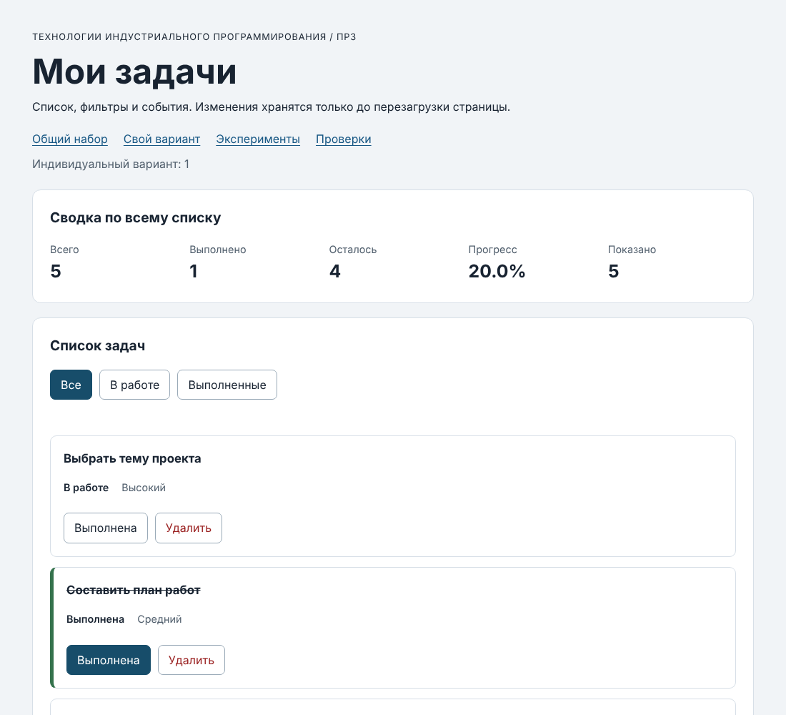

# Практическая работа № 3. Работа с DOM и событиями

## Данные работы

| Поле | Значение |
|---|---|
| Имя | Степанов Владимир |
| Группа | ЭФБО-17-25 |
| Вариант из ПР2 | 1 — «Подготовка учебного проекта» |
| Node.js | ___ <!-- node --version --> |
| Браузер | ___ <!-- например, Google Chrome 1xx --> |
| Операционная система | macOS ___ |

## Запуск

Рабочая папка: `practice-03` внутри личного репозитория.

```bash
cd practice-03
npm run check:service
npm start
```

Устанавливать зависимости через `npm install` не требуется.

```text
http://127.0.0.1:5503/
http://127.0.0.1:5503/index.html?dataset=variant
http://127.0.0.1:5503/examples/dom-events.html
http://127.0.0.1:5503/checks.html
```

Остановка сервера: `Ctrl+C`. Открывать `index.html` двойным щелчком нельзя: ES-модули по протоколу `file://` браузер не загружает.

## Что перенесено из ПР2

`src/task-service.js` и `src/data.js` скопированы из `practice-02/src` без изменений (в `data.js` — `variantNumber = 1` и шесть задач варианта). Повторная проверка `npm run check:service`: 35 из 35. `main.js` из ПР2 не переносился — там был консольный сценарий.

## Эксперименты

| № | До запуска: прогноз | После запуска: результат | Объяснение |
|---:|---|---|---|
| 1. Отсутствующий элемент и коллекция | `null` и `0` | `Отсутствующий элемент: null`, `Пустая коллекция: 0` | `querySelector` при отсутствии совпадений возвращает `null` (обращение к его свойствам вызовет ошибку), а `querySelectorAll` — пустой `NodeList` длины 0, с ним можно безопасно работать. |
| 2. dataset и числовой id | `"23"` строкой, после `Number` — `23` | `dataset.taskId: 23 string`, `Числовой id: 23` (number) | Атрибуты `data-*` всегда хранятся как строки; для сравнения с `id` задачи (числом) нужно явное `Number()`. |
| 3. Статический NodeList | старый список останется 1, новый — 2, затем 3 | `Старый NodeList: 1`, `Новый querySelectorAll: 2`; при втором нажатии 1 и 3 | `querySelectorAll` возвращает **статический** снимок на момент вызова; добавленные позже элементы в него не попадают. Нужен новый запрос. |
| 4. Строка с HTML-разметкой | текст с угловыми скобками, без жирного шрифта | заголовок показывает `<strong>Это текст, а не HTML</strong>`; элементов `strong` внутри 0 | `textContent` записывает строку как текст, теги не разбираются. Поэтому названия задач выводятся через `textContent`, а не `innerHTML`. |
| 5. Распространение события | захват на `lab-card` → кнопка → всплытие на `lab-card` | `1. phase=1; target=lab-label; currentTarget=lab-card`, `2. phase=3; target=lab-label; currentTarget=lab-button`, `3. phase=3; target=lab-label; currentTarget=lab-card` | `target` — всегда фактически нажатый `span`, `currentTarget` — элемент, чей обработчик сейчас работает. Событие идёт вниз (захват, phase 1), затем поднимается (всплытие, phase 3), поэтому обработчик контейнера получает клик по вложенному элементу. На этом основано делегирование. |

## Организация кода

| Файл | Что делает |
|---|---|
| `task-service.js` | функции ПР2: проверки, поиск, сводка, `setTaskCompleted`, `removeTask`; без `document` |
| `task-selectors.js` | `getVisibleTasks(tasks, filter)` — отбор по фильтру `all` / `pending` / `completed` |
| `task-view.js` | создание карточки (`createTaskElement`), список (`renderTaskList`), сводка (`renderSummary`), пустое состояние (`renderEmptyState`); данные не меняет |
| `main.js` | состояние и события |

Полный список хранится в `currentTasks`, фильтр — в `currentFilter` (обе переменные в `main.js`). События обрабатываются **одним** делегированным обработчиком на `#task-list` (`handleTaskListClick`) и одним на `#task-filters` (`handleFilterClick`); подписка выполняется один раз, а не в `renderApp`. Сводка считается через `getTaskStats(currentTasks)` по полному массиву — фильтр меняет только «Показано».

Путь одного клика «Выполнена»: `event.target` (может быть `span`) → `closest("button[data-action]")` → проверка `action` → `closest("li[data-task-id]")` → `Number(dataset.taskId)` и проверка → `findTaskById` → `setTaskCompleted(currentTasks, id, !task.completed)` → при `ok` сохраняем `result.tasks` → `renderApp()` → `restoreTaskFocus`.

## Общий сценарий

| Шаг | Видимые id | Всего | Выполнено | Осталось | Прогресс | Показано | Сообщение | Совпало с ожиданием |
|---:|---|---|---|---|---|---|---|---|
| 0 | [1, 4, 7, 10] | 4 | 2 | 2 | 50.0% | 4 | — | да |
| 1 | [4, 7] | 4 | 2 | 2 | 50.0% | 2 | — | да |
| 2 | [7] | 4 | 3 | 1 | 75.0% | 1 | — | да |
| 3 | [1, 4, 7, 10] | 4 | 3 | 1 | 75.0% | 4 | — | да |
| 4 | [1, 4, 10] | 3 | 3 | 0 | 100.0% | 3 | — | да |
| 5 | [] | 3 | 3 | 0 | 100.0% | 0 | Нет задач по выбранному фильтру. | да |
| 6 | [1, 4, 10] | 3 | 2 | 1 | 66.7% | 3 | — | да |
| 7 | [] | 0 | 0 | 0 | 0.0% | 0 | Список задач пуст. | да |

После перезагрузки: снова шаг 0 (`[1, 4, 7, 10]`, 50.0%) — изменения хранятся только в памяти, это ожидаемо.

## Индивидуальный вариант

Тема: «Подготовка учебного проекта». Исходные задачи (все не выполнены, K = 0): 11 «Выбрать тему проекта» (high), 23 «Составить план работ» (medium), 37 «Найти источники» (low), 41 «Создать репозиторий» (medium), 58 «Написать первую версию» (high), 64 «Подготовить презентацию» (low).

| Этап | Всего | Выполнено | Осталось | Прогресс | Видимые id |
|---|---|---|---|---|---|
| До действий | 6 | 0 | 6 | 0.0% | [11, 23, 37, 41, 58, 64]; «В работе» — те же 6; «Выполненные» — [] («Нет задач по выбранному фильтру.») |
| После переключения 23 | 6 | 1 | 5 | 16.7% | [11, 23, 37, 41, 58, 64] |
| После удаления 37 | 5 | 1 | 4 | 20.0% | [11, 23, 41, 58, 64] |
| Итог, фильтр «В работе» | 5 | 1 | 4 | 20.0% | [11, 41, 58, 64] |
| Итог, фильтр «Выполненные» | 5 | 1 | 4 | 20.0% | [23] |

Совпадает с ожиданием методички для варианта 1: выполнено 1, прогресс 20.0%.

## Протокол проверки сервиса

```text
OK: 01. Создание задачи с явным приоритетом
OK: 02. Приоритет по умолчанию
OK: 03. Удаление краевых пробелов без изменения внутренних
OK: 04. Граничные длины названия и положительный безопасный id
OK: 05. Некорректные названия при создании
OK: 06. Некорректные идентификаторы при создании
OK: 07. Все допустимые приоритеты и отклонение недопустимых
OK: 08. Каждый вызов createTask возвращает новый объект
OK: 09. Поиск по id, а не по индексу
OK: 10. Отсутствующая задача и пустой массив при поиске
OK: 11. Поиск не преобразует строковый id в число
OK: 12. Получение невыполненных задач
OK: 13. Пустой список, все выполнены и все не выполнены
OK: 14. Названия в исходном порядке и пустой список
OK: 15. Сводка по общему набору
OK: 16. Сводка по пустому списку
OK: 17. Сводка: ничего не выполнено и выполнено всё
OK: 18. Процент остаётся числом без предварительного округления
OK: 19. Добавление в конец без изменения входного массива
OK: 20. Добавление в пустой список с приоритетом по умолчанию
OK: 21. Повторяющийся id отклоняется
OK: 22. Добавление не обходит проверки createTask
OK: 23. Изменение completed в обе стороны
OK: 24. completed принимает только boolean
OK: 25. Некорректный или отсутствующий id при изменении статуса
OK: 26. Повторная установка статуса создаёт новый результат
OK: 27. Переименование сохраняет остальные поля
OK: 28. Проверки названия при переименовании
OK: 29. Некорректный или отсутствующий id при переименовании
OK: 30. Удаление по id с сохранением порядка
OK: 31. Удаление единственной записи
OK: 32. Некорректный, отсутствующий id и удаление из пустого списка
OK: 33. Входные объекты не изменяются ни одной операцией
OK: 34. Общий сценарий и все промежуточные сводки
OK: 35. Работа с другим набором, без зависимости от demoTasks

Проверок пройдено: 35; не пройдено: 0.
```

## Протокол браузерных проверок

```text
OK: Фильтр all возвращает новый массив в исходном порядке
OK: Фильтр pending выбирает невыполненные задачи
OK: Фильтр completed выбирает выполненные задачи
OK: Все три фильтра работают с пустым списком
OK: Фильтрация не меняет входные записи и их порядок
OK: Карточка — li.task-card с числовым id в dataset
OK: Статус невыполненной карточки и aria-pressed согласованы
OK: Статус выполненной карточки и aria-pressed согласованы
OK: В карточке две обычные кнопки с вложенными подписями
OK: Все приоритеты отображаются по установленному словарю
OK: Название с разметкой отображается текстом
OK: Отрисовка списка создаёт карточки в исходном порядке
OK: Повторная отрисовка не накапливает карточки
OK: Контейнер списка и его обработчик сохраняются
OK: Отрисовка пустого массива очищает прежние карточки
OK: Сводка считается по всему списку, отдельно выводится Показано
OK: Пустая сводка не содержит NaN и Infinity
OK: Сообщение для полностью пустого списка
OK: Сообщение для пустого результата фильтра
OK: Появление карточек скрывает прежнее пустое состояние
OK: Приложение: начальный набор и сводка
OK: Приложение: фильтр срабатывает по клику на вложенный span
OK: Приложение: активный фильтр отмечен классом и aria-pressed
OK: Приложение: фильтрация не удаляет скрытые задачи
OK: Приложение: переключение по id, а не индексу массива
OK: Приложение: выполненная задача исчезает из фильтра В работе
OK: Приложение: удаление изменяет данные, а не только DOM
OK: Приложение: клик по названию не изменяет данные
OK: Приложение: после перерисовок одно нажатие — одно изменение
OK: Приложение: удаление всех записей и нулевая сводка
OK: Приложение: нет совпадений — не то же самое, что нет задач
OK: Приложение: неизвестный числовой id не меняет данные
OK: Приложение: id 4abc не превращается в 4
OK: Приложение: неизвестное действие игнорируется
OK: Приложение: после изменения сохраняется клавиатурный фокус
OK: Приложение: новая загрузка возвращает исходное состояние

Всего: 36. Пройдено: 36. Ошибок: 0.
```

## Собственные проверки

| № | Исходное состояние и действия | Ожидаемый результат | Фактический результат | Итог |
|---:|---|---|---|---|
| 1 | Граничное: вариант 1 (все не выполнены), фильтр «Выполненные» | список пуст, «Нет задач по выбранному фильтру.», сводка 6 / 0 / 6 / 0.0%, показано 0 | так и есть | Пройдено |
| 2 | Событие и перерисовка: общий набор, два нажатия подряд на подпись `span` кнопки «Выполнена» у id 4 | каждое нажатие меняет статус ровно один раз → вернулись к 4 / 2 / 2 / 50.0%; фокус остаётся на кнопке id 4 | 4 / 2 / 2 / 50.0%, фокус на `toggle` id 4 | Пройдено |
| 3 | Действие после смены фильтра: «Выполненные» (видны 1, 10), снять выполнение с id 1 | карточка 1 исчезает из выборки, видна только 10; сводка 4 / 1 / 3 / 25.0%; фокус переходит на кнопку активного фильтра | [10], 4 / 1 / 3 / 25.0%, показано 1, фокус на «Выполненные» | Пройдено |

## Отладка и клавиатура

Точка останова — строка `const id = Number(card.dataset.taskId);` в `handleTaskListClick` (нажатие на подпись кнопки «Выполнена» у задачи 4 в общем наборе):
- `event.target` — `span.action-label`, `event.currentTarget` — `ul#task-list`;
- `card.dataset.taskId` — `"4"` (string), после преобразования `id` — `4` (number);
- `action` — `"toggle"`, найденная задача — `{ id: 4, title: "Подготовить модель задач", completed: false, priority: "high" }`;
- результат `setTaskCompleted` — `{ ok: true, tasks: [...] }`, в новом массиве у id 4 `completed: true`, а в старом `currentTasks` — по-прежнему `false`.

Клавиатура: Tab переходит по фильтрам и кнопкам карточек; Enter и Space на кнопке «Выполнена» работают так же, как клик (это настоящие `button`). После изменения статуса фокус остаётся на той же кнопке пересозданной карточки, после удаления — переходит на кнопку активного фильтра.

Отказы через атрибут карточки (Elements → изменить `data-task-id` у карточки 4):
- `777` → «Задача с id 777 не найдена.», данные и сводка не изменились (4 / 2 / 2 / 50.0%);
- `4abc` → «Некорректный идентификатор задачи: «4abc».», данные не изменились (`Number("4abc")` — `NaN`).
- Клик по названию карточки ничего не меняет (кнопка не найдена через `closest`).

## Вид приложения



## Дополнительное задание

Дополнительное задание не выполнялось.

## Вывод

Интерфейс собран из модулей: данные и их изменение — в `task-service.js` из ПР2, отбор — в `task-selectors.js`, DOM — в `task-view.js`, состояние и события — в `main.js`. Изменение данных и изменение DOM разделены: кнопка не меняет карточку напрямую, а вызывает функцию ПР2, сохраняет новый массив и полностью перерисовывает интерфейс из него, поэтому DOM всегда соответствует данным. Делегирование (один обработчик на списке + `closest`) работает и для пересоздаваемых карточек, и для кликов по вложенному `span`. Идентификатор из `dataset` — строка, поэтому он явно переводится в число и проверяется; некорректные значения (`777`, `4abc`) не портят состояние.
